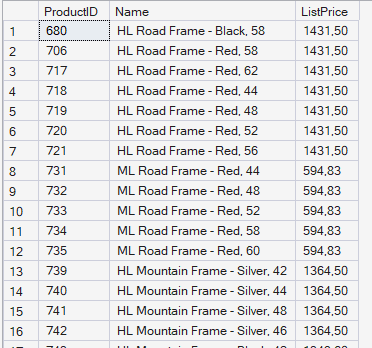
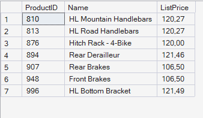
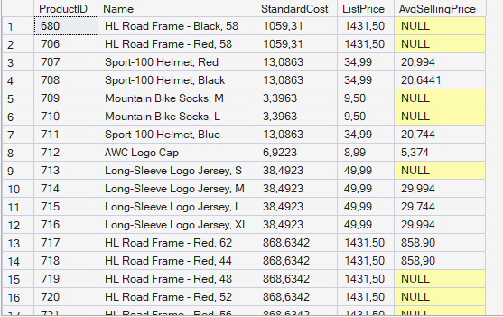
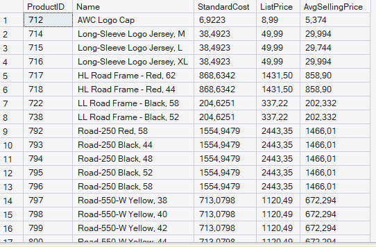
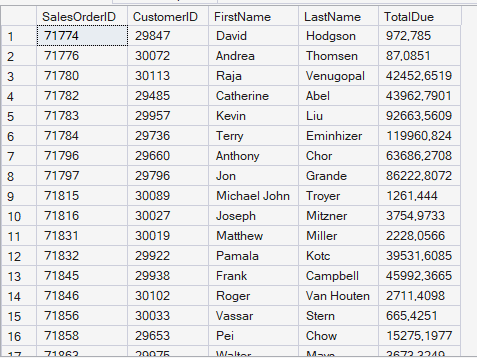
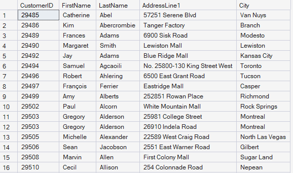

# Отчет по лабораторной работе №6

## Задача 1: Получение информации о ценах на товары.

Каждый товар Adventure Works имеет себестоимость, которая учитывает стоимость изготовления товара,
и прейскурантную цену, которая показывает рекомендуемую розничную цену продажи товара. Эти
данные хранятся в таблице SalesLT.Product. Всякий раз, когда товар заказывается, фактическая цена за
которую был продан товар также записывается в таблицу SalesLT.SalesOrderDetail. Вы должны
использовать подзапросы, чтобы сравнить себестоимость и прейскурантную цену по которой товар был
продан для каждого заказа. Все результаты запроса должны быть отсортированы по ProductID

### 1. Получите товары, у которых прейскурантная цена выше средней цены за товар.
Получите идентификатор товара, наименование и прейскурантную цену для каждого товара, чья
прейскурантная цена выше средней цены за единицу товара для всех проданных товаров.

### Решение-запрос:
```SQL
SELECT ProductID, Name, ListPrice 
FROM SalesLT.Product 
WHERE ListPrice > (
      SELECT AVG(UnitPrice) 
      FROM SalesLT.SalesOrderDetail
)
ORDER BY ProductID;
```

### Вывод программы.


### 2. Получите товары с прейскурантной ценой в 100 долларов или более, которые были проданы менее чем за 100 долларов.
Получить идентификатор товара, наименование и прейскурантную цену для каждого товара, чья
прейскурантная цена составляет $100 или более, а товар продан менее чем за $100.

### Решение-запрос:
```SQL
SELECT p.ProductID,
       p.Name,
       p.ListPrice
FROM SalesLT.Product AS p
WHERE p.ListPrice >= 100
  AND p.ProductID IN (
        SELECT sod.ProductID
        FROM SalesLT.SalesOrderDetail AS sod
        WHERE sod.UnitPrice < 100
      )
ORDER BY p.ProductID;
```

### Вывод программы:


### 3.  Получите себестоимость, прейскурантную цену и среднюю цену продажи для каждого товара.

Получите идентификатор товара, наименование, себестоимость (столбец StandardCost) и прейскурантную
цену для каждого товара из таблицы Products вместе со средней ценой продажи единицы данного товара
в столбце AvgSellingPrice.

### Решение-запрос:
```SQL
SELECT 
     p.ProductID,
     p.Name,
     p.StandardCost,
     p.ListPrice,
     (
       SELECT AVG(sod.UnitPrice)
       FROM SalesLT.SalesOrderDetail AS sod
       WHERE sod.ProductID = p.ProductID
     ) AS AvgSellingPrice
FROM SalesLT.Product AS p
ORDER BY p.ProductID;

```



### 4. Получите товары у которых средняя цена продажи ниже себестоимости.
Отфильтруйте предыдущий запрос так, чтобы включить только товары, где себестоимость выше средней
цены продажи товара.

### Решение-запрос:
```SQL
SELECT p.ProductID,
       p.Name,
       p.StandardCost,
       p.ListPrice,
       (
         SELECT AVG(sod.UnitPrice)
         FROM SalesLT.SalesOrderDetail AS sod
         WHERE sod.ProductID = p.ProductID
       ) AS AvgSellingPrice
FROM SalesLT.Product AS p
WHERE p.StandardCost > (
        SELECT AVG(sod.UnitPrice)
        FROM SalesLT.SalesOrderDetail AS sod
        WHERE sod.ProductID = p.ProductID
      )
ORDER BY p.ProductID;
```
### Вывод программы:


## Задача 2. Получение информации о клиенте.
База данных AdventureWorksLT включает в себя определяемую пользователем табличную функцию с
именем dbo.ufnGetCustomerInformation. Вы должны использовать эту функцию для получения сведений
о клиентах на основе значений идентификаторов клиента, полученных из таблиц в базе данных.

### 1. Получите информацию о клиентах для всех заказов
Получите идентификатор заказа, идентификатор клиента, имя, фамилию и общую сумму (TotalDue) для
всех заказов из таблицы SalesLT.SalesOrderHeader и функции dbo.ufnGetCustomerInformation.
Необходимо отсортировать результаты по SalesOrderID.

### Решение-запрос:

```SQL
SELECT soh.SalesOrderID,
       soh.CustomerID,
       ci.FirstName,
       ci.LastName,
       soh.TotalDue
FROM SalesLT.SalesOrderHeader AS soh
CROSS APPLY dbo.ufnGetCustomerInformation(soh.CustomerID) AS ci
ORDER BY soh.SalesOrderID;
```
### Вывод программы:


### 2. Получите информацию об адресе клиента.
Получите идентификатор клиента, имя, фамилию, адресную строку 1 и город для всех клиентов из таблиц
SalesLT.Address и SalesLT.CustomerAddress и функции dbo.ufnGetCustomerInformation. Необходимо
отсортировать результаты по CustomerID.

### Решение-запрос:
```SQL
SELECT ca.CustomerID,
       ci.FirstName,
       ci.LastName,
       a.AddressLine1,
       a.City
FROM SalesLT.CustomerAddress AS ca
JOIN SalesLT.Address AS a
     ON a.AddressID = ca.AddressID
CROSS APPLY dbo.ufnGetCustomerInformation(ca.CustomerID) AS ci
ORDER BY ca.CustomerID;
```
### Вывод программы:


