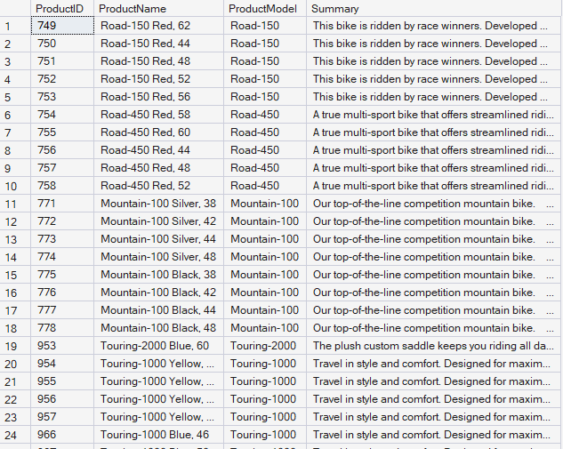
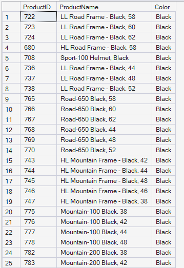
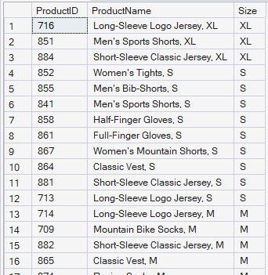
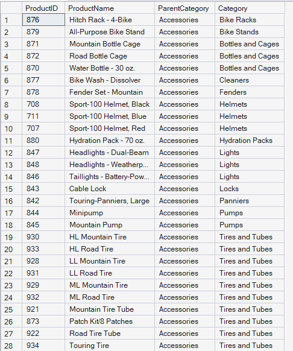
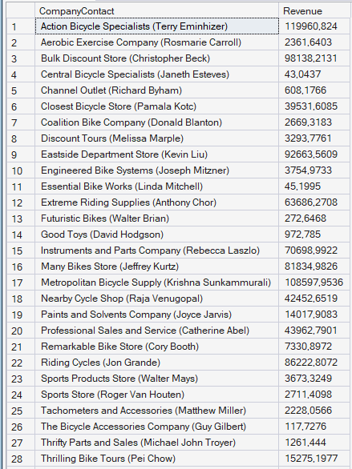
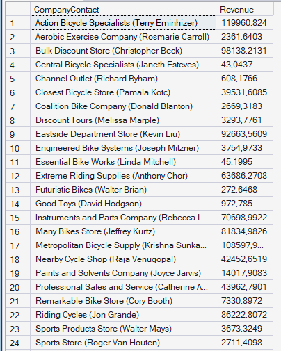

# Отчет по Лабораторной работе №7

## Задача 1: Получение данных о товаре.
Компания Adventure Works продает много товаров, которые являются разновидностями одной и той же модели
товара. Вам необходимо написать запрос, который извлекает из БД информацию об этих товарах.
### 1. Получите описания модели товара.
Получите идентификатор товара, название товара (столбец ProductName), название модели товара (столбец
ProductModel) и описание модели товара (столбец Summary) для каждого товара из таблицы SalesLT.Product и
отображения SalesLT.vProductModelCatalogDescription, упорядочив результаты по идентификатору товара.

### Решение-запрос:
```SQL
SELECT
    p.ProductID,
    p.Name AS ProductName,
    v.Name AS ProductModel,
    v.Summary
FROM SalesLT.Product AS p
INNER JOIN SalesLT.vProductModelCatalogDescription AS v
    ON p.ProductModelID = v.ProductModelID
ORDER BY p.ProductID;
```

### Вывод программы:


### 2. Создайте таблицу с уникальными цветами.
Создайте табличную переменную и заполните ее списком уникальных цветов из таблицы SalesLT.Product. Затем
используйте табличную переменную, чтобы отфильтровать запрос, который возвращает идентификатор товара,
название товара (столбец ProductName) и цвет (столбец Color) из таблицы SalesLT.Product, упорядочивая по
цветам так, чтобы возвращались только те товары, цвета которых перечислены в табличной переменной.

### Решение-запрос:
```SQL
DECLARE @Colors TABLE (
    Color NVARCHAR(15)
);

INSERT INTO @Colors (Color)
SELECT DISTINCT Color
FROM SalesLT.Product
WHERE Color IS NOT NULL;

SELECT
    ProductID,
    Name AS ProductName,
    Color
FROM SalesLT.Product
WHERE Color IN (SELECT Color FROM @Colors)
ORDER BY Color;
```
### Вывод программы:


### 3. Создайте таблицу с уникальными размерами
Создайте временную таблицу и заполните ее списком уникальных размеров из таблицы SalesLT.Product. Затем
используйте временную таблицу, чтобы отфильтровать запрос, который возвращает идентификатор товара,
название товара (столбец ProductName) и размер (столбец Size) из таблицы SalesLT.Product, упорядочивая по
размерам по убыванию так, чтобы возвращались только те товары, размеры которых перечислены во временной
таблице.
```SQL
CREATE TABLE #Sizes (
    Size NVARCHAR(5) COLLATE DATABASE_DEFAULT
);

INSERT INTO #Sizes (Size)
SELECT DISTINCT Size
FROM SalesLT.Product
WHERE Size IS NOT NULL;

SELECT
    ProductID,
    Name AS ProductName,
    Size
FROM SalesLT.Product
WHERE Size IN (SELECT Size FROM #Sizes)
ORDER BY Size DESC;

DROP TABLE #Sizes;
```
### Вывод программы:


### 4. Получите родительские категории товаров.
БД AdventureWorksLT содержит табличную функцию dbo.ufnGetAllCategories, которая возвращает таблицу
товарных категорий (например «Road Bikes») и их родительских категорий (например «Bikes»). Напишите запрос,
которых использует эту функцию, чтобы вернуть список всех товаров (столбцы ProductID, ProductName) включая их
родительские категории (столбец ParentCategory) и категории (столбец Category), упорядоченные по
соответствующему полному пути категорий (т.е. названию категории, включая название родительской категории)
и названию товара.
```SQL
SELECT 
   P.ProductID,
   P.Name AS ProductName,
   AC.ParentProductCategoryName AS ParentCategory,
   AC.ProductCategoryName AS Category
FROM SalesLT.Product as P
INNER JOIN dbo.ufnGetAllCategories() AS AC on P.ProductCategoryID = AC.ProductCategoryID
ORDER BY ParentCategory, Category, ProductName;
```
### Вывод прогаммы:


## Задача 2. Получение информации по доходам от продаж клиентам
Каждый клиент Adventure Works является розничной компанией с контактным лицом. Вы должны создать
запросы, которые возвращают общую выручку по каждому клиенту, включая компанию и имена контактных лиц.
### 1. Получите доходы от продаж по клиентам и контактные данные (используйте производные таблицы)
Получите список клиентов в формате “Название_Компании (Имя_Контакта Фамилия_Контакта)” в столбце
CompanyContact (например, значение может быть “Action Bicycle Specialists (Terry Eminhizer)”), значение
полученной выручки (сумма значений TotalDue) для этого клиента (столбец Revenue). Используйте производную
таблицу, чтобы получить сведения по каждому заказу и затем постройте запрос к полученной производной
таблице, чтобы сгруппировать данные. Результаты должны быть упорядочены по значениям в CompanyContact.
```SQL
SELECT 
   CompanyContact, SUM(TotalDue) AS Revenue
FROM (SELECT CONCAT(C.CompanyName, ' (', C.FirstName, ' ', C.LastName, ')') as CompanyContact,
   SOH.TotalDue
FROM SalesLT.Customer C
JOIN SalesLT.SalesOrderHeader SOH on C.CustomerID = SOH.CustomerID) as CustomerSales
GROUP BY CompanyContact
ORDER BY CompanyContact;
```
### Вывод программы:


### 2. Получите доходы от продаж по клиентам и контактные данные (используйте CTE – обобщенные табличные выражения)
Перепишите предыдущий запрос с помощью CTE (обобщенного табличного выражения) вместо производных
таблиц.
```SQL
WITH Companies(CompanyContact, TotalDue)
   AS
     (SELECT CONCAT(CompanyName, ' (', FirstName, ' ', LastName, ')') AS CompanyContact, TotalDue
      FROM SalesLT.Customer C
      INNER JOIN SalesLT.SalesOrderHeader ON C.CustomerID = SalesOrderHeader.CustomerID)
SELECT 
    CompanyContact, SUM(TotalDue) AS Revenue
FROM Companies
GROUP BY CompanyContact
ORDER BY CompanyContact;
```
### Вывод программы:

