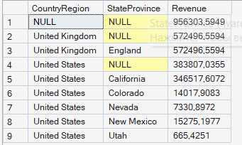
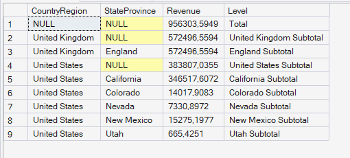
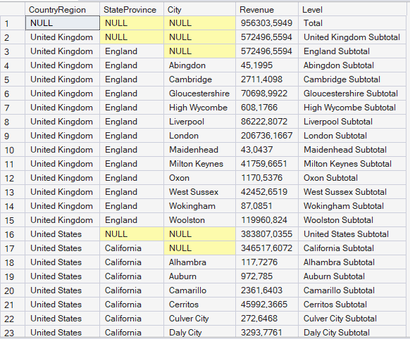
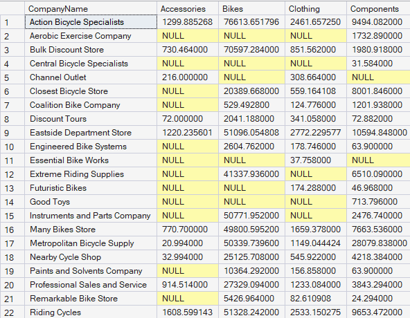

# Отчет по лабораторной работе №8.

## Задача 1. Получение итогов продаж по регионам.
Компания Adventure Works продает товары клиентам, расположенным в различных странах / регионах по всему
миру.
### 1. Получите итоги для страны/региона и штата/провинции.
В существующем отчете используется следующий запрос, чтобы вернуть общий доход от продаж, сгруппированный
по стране/региону и штату/провинции.
```SQL
SELECT a.CountryRegion, a.StateProvince, SUM(soh.TotalDue) AS Revenue
FROM SalesLT.Address AS a
INNER JOIN SalesLT.CustomerAddress AS ca ON a.AddressID = ca.AddressID
INNER JOIN SalesLT.Customer AS c ON ca.CustomerID = c.CustomerID
INNER JOIN SalesLT.SalesOrderHeader as soh ON c.CustomerID = soh.CustomerID
GROUP BY a.CountryRegion, a.StateProvince
ORDER BY a.CountryRegion, a.StateProvince;
```
Вам необходимо изменить этот запрос, чтобы результаты включали общую сумму всех доходов от продаж и
промежуточную сумму для каждой страны/региона в дополнение к промежуточным суммам по
штатам/провинциям, которые уже возвращены.

### Решение-запрос(измененный запрос):
```SQL
SELECT
    a.CountryRegion,
    a.StateProvince,
    SUM(soh.TotalDue) AS Revenue
FROM SalesLT.Address AS a
INNER JOIN SalesLT.CustomerAddress AS ca
    ON a.AddressID = ca.AddressID
INNER JOIN SalesLT.Customer AS c
    ON ca.CustomerID = c.CustomerID
INNER JOIN SalesLT.SalesOrderHeader AS soh
    ON c.CustomerID = soh.CustomerID
GROUP BY ROLLUP (a.CountryRegion, a.StateProvince)
ORDER BY a.CountryRegion, a.StateProvince;
```
### Вывод программы:


### 2. Укажите уровни группировки в результатах.
Измените свой предыдущий запрос, чтобы включить столбец с именем «Level», который указывает, на каком уровне
в иерархии отображается показатель дохода в строке: итоговом, страна/регион и штат/провинция. Например,
общая итоговая строка должна содержать значение «Total», строка, показывающая промежуточный итог для
Соединенных Штатов, должна содержать значение «United States Subtotal», а строка, показывающая
промежуточный итог для Калифорнии, должна содержать значение «California Subtotal».

### Решение-запрос(измененный запрос):
```SQL
SELECT
    a.CountryRegion,
    a.StateProvince,
    SUM(soh.TotalDue) AS Revenue,
    CASE 
        WHEN GROUPING(a.CountryRegion) = 1
           THEN 'Total'
        WHEN GROUPING(a.StateProvince) = 1
           THEN a.CountryRegion + ' Subtotal'
        ELSE a.StateProvince + ' Subtotal'
    END AS Level
FROM SalesLT.Address AS a
INNER JOIN SalesLT.CustomerAddress AS ca
    ON a.AddressID = ca.AddressID
INNER JOIN SalesLT.Customer AS c
    ON ca.CustomerID = c.CustomerID
INNER JOIN SalesLT.SalesOrderHeader AS soh
    ON c.CustomerID = soh.CustomerID
GROUP BY ROLLUP(a.CountryRegion, a.StateProvince)
ORDER BY a.CountryRegion, a.StateProvince;
```

### Вывод программы:


### 3.  Добавьте уровень группировки для городов.
Расширьте свой предыдущий запрос, чтобы включить столбец «City» (после столбца StateProvince) и группировку
для отдельных городов. Измените правила для столбца «Level» так, чтобы строка, показывающая промежуточный
итог для города Лондон, содержала значение «London Subtotal». Добавьте столбец City в выражение сортировки
результатов.

### Решение-запрос(измененный запрос):
```SQL
SELECT
    a.CountryRegion,
    a.StateProvince,
    a.City,
    SUM(soh.TotalDue) AS Revenue,
    CASE 
        WHEN GROUPING(a.CountryRegion) = 1
           THEN 'Total'
        WHEN GROUPING(a.StateProvince) = 1
           THEN a.CountryRegion + ' Subtotal'
        WHEN GROUPING(a.City) = 1
           THEN a.StateProvince + ' Subtotal'
        ELSE a.City + ' Subtotal'
    END AS Level
FROM SalesLT.Address AS a
INNER JOIN SalesLT.CustomerAddress AS ca
    ON a.AddressID = ca.AddressID
INNER JOIN SalesLT.Customer AS c
    ON ca.CustomerID = c.CustomerID
INNER JOIN SalesLT.SalesOrderHeader AS soh
    ON c.CustomerID = soh.CustomerID
GROUP BY ROLLUP(a.CountryRegion, a.StateProvince, a.City)
ORDER BY a.CountryRegion, a.StateProvince, a.City;
```

### Вывод программы:


## Задача 2: Получение доходов от продаж по категориям.
Продукты Adventure Works группируются по категориям, которые, в свою очередь, имеют родительские категории
(определенные в представлении SalesLT.vGetAllCategories). Клиенты Adventure Works являются компаниями
розничной торговли, и они могут размещать заказы на продукцию любой категории. Доход каждого товара в заказе
записывается как значение в столбце LineTotal таблицы SalesLT.SalesOrderDetail.
### 1. Получите доход от продаж для каждой родительской категории.
Получите список названий компаний-клиентов (столбец CompanyName), их общий доход (сумма значений LineTotal
в таблице SalesLT.SalesOrderDetail) для каждой родительской категории в разделах Accessories, Bikes, Clothing и
Components (в соответствующих столбцах Accessories, Bikes, Clothing и Components). Отсортируйте результаты
запроса по названию компании.
```SQL
SELECT
    CompanyName,
    Accessories,
    Bikes,
    Clothing,
    Components
FROM
(
    SELECT
        c.CompanyName,
        pc_parent.Name AS CategoryName,
        sod.LineTotal
    FROM SalesLT.Customer AS c
    INNER JOIN SalesLT.SalesOrderHeader AS soh
        ON c.CustomerID = soh.CustomerID
    INNER JOIN SalesLT.SalesOrderDetail AS sod
        ON soh.SalesOrderID = sod.SalesOrderID
    INNER JOIN SalesLT.Product AS p
        ON sod.ProductID = p.ProductID
    INNER JOIN SalesLT.ProductCategory AS pc
        ON p.ProductCategoryID = pc.ProductCategoryID
    INNER JOIN SalesLT.ProductCategory AS pc_parent
        ON pc.ParentProductCategoryID = pc_parent.ProductCategoryID
) AS SourceTable
PIVOT
(
    SUM(LineTotal)
    FOR CategoryName IN
    (
        Accessories,
        Bikes,
        Clothing,
        Components
    )
) AS PivotTable
ORDER BY CompanyName;
```
