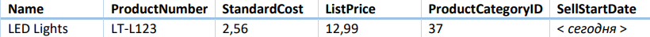
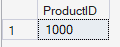
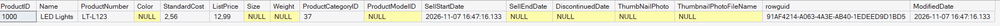
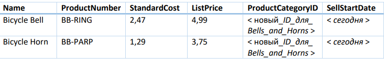
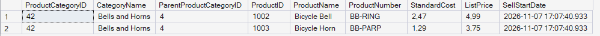
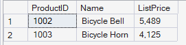
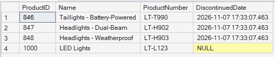
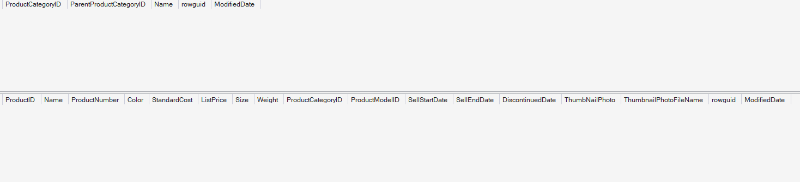

# Отчет по лабораторной работе №9.

## Задача 1: Добавление товаров.
Каждый товар компании Adventure Works хранится в таблице **SalesLT.Product** и имеет уникальный
идентификатор **ProductID**, реализованный в виде IDENTITY-столбца. Товары сгруппированы в категории,
которые определены в таблице **SalesLT.ProductCategory**. Записи товаров и товарных категорий связаны
общим идентификатором **ProductCategoryID**, который является IDENTITY-столбцом в таблице
**SalesLT.ProductCategory**.

### 1. Добавьте товар.
Компания Adventure Works начала продавать новый товар. Добавьте его в таблицу **SalesLT.Product**,
используя значения по умолчанию или NULL для неуказанных столбцов (используйте синтаксис с явно
указанными именами столбцов):



После того, как вы добавили товар, напишите и выполните запрос, чтобы определить значение
**ProductID**, которое было сгенерировано (запрос должен возвращать только столбец **ProductID**). Затем
напишите и выполните запрос, чтобы просмотреть все строку целиком (все столбцы) для добавленного
вами товара в таблице **SalesLT.Product**.

### Решение-запрос:
```SQL
INSERT INTO SalesLT.Product (Name, ProductNumber, StandardCost, ListPrice, ProductCategoryID, SellStartDate)
VALUES ('LED Lights', 'LT-L123', 2.56, 12.99, 37, GETDATE());
-- Только для ProductID:
SELECT SCOPE_IDENTITY() AS ProductID;
-- Для того чтобы вывести всю строчку:
SELECT *
FROM SalesLT.Product
WHERE ProductID = SCOPE_IDENTITY();
```
### Вывод программы для ProductID:


### Вывод программы для всей добавленной строки:


### 2. Добавьте новую товарную категорию с двумя товарами.
Компания Adventure Works добавляет в свой каталог категорию товаров «Bells and Horns».
Идентификатор родительской категории для новой категории = 4 (Accessories). Эта новая категория
включает в себя следующие два новых товара:



Напишите запрос, чтобы добавить новую категорию товаров «Bells and Horns», а затем добавьте два
новых товара с соответствующим значением **ProductCategoryID** (программно определите
идентификатор категории «Bells and Horns» во время вставки и далее используйте его для добавления
новых товаров; используйте синтаксис с явным указанием имен столбцов).
После того, как вы добавили товары, напишите один запрос к двум таблицам **SalesLT.Product** и
**SalesLT.ProductCategory**, чтобы убедиться, что данные были вставлены успешно.

## Решение:
**1.** Сначало создаем новую категорию **«Bells and Horns»**:
```SQL
INSERT INTO SalesLT.ProductCategory (ParentProductCategoryID, Name)
VALUES (4, 'Bells and Horns');
```
**2.** Добавление двух товаров с программным определением ID новой категории:
```SQL
DECLARE @CategoryID INT = SCOPE_IDENTITY();

INSERT INTO SalesLT.Product (Name, ProductNumber, StandardCost, ListPrice, ProductCategoryID, SellStartDate)
VALUES ('Bicycle Bell', 'BB-RING', 2.47, 4.99, @CategoryID, GETDATE()),
       ('Bicycle Horn', 'BB-PARP', 1.29, 3.75, @CategoryID, GETDATE());
```
**3.** Проверка одним запросом к двум таблицам **SalesLT.Product** и **SalesLT.ProductCategory**:
```SQL
SELECT c.ProductCategoryID,
       c.Name AS CategoryName,
       c.ParentProductCategoryID,
       p.ProductID,
       p.Name AS ProductName,
       p.ProductNumber,
       p.StandardCost,
       p.ListPrice,
       p.SellStartDate
FROM SalesLT.ProductCategory AS c
INNER JOIN SalesLT.Product AS p
    ON p.ProductCategoryID = c.ProductCategoryID
WHERE c.Name = 'Bells and Horns';
```

### Вывод программы:



## Задача 2: Обновление информации по товарам
Вы добавили данные для товаров, но оказалось, что данные о ценах неверны. Теперь вы должны
обновить записи, которые вы вставили ранее, чтобы отразить правильную цену
### 1. Обновление цен на товары.
Менеджер по продажам в компании Adventure Works принял решение на 10 % повысить цены для всех
товаров из категории «Bells and Horns». Обновите строки в таблице **SalesLT.Product** для этих товаров,
чтобы увеличить их цену (столбец **ListPrice**) на 10% (ссылайтесь на категорию товаров по названию).

### Решение-запрос:
```SQL
UPDATE SalesLT.Product
SET ListPrice = ListPrice * 1.10
WHERE ProductCategoryID = (SELECT ProductCategoryID FROM SalesLT.ProductCategory WHERE Name = 'Bells and Horns');
```
Вывод данных:
```SQL
SELECT p.ProductID, p.Name, p.ListPrice
FROM SalesLT.Product AS p
INNER JOIN SalesLT.ProductCategory AS c
    ON p.ProductCategoryID = c.ProductCategoryID
WHERE c.Name = 'Bells and Horns';
```
### Вывод программы:


**можно заметить что цены по сравнению с фото с прошлого задания реально изменились на 10 %**

### 2. Прекращение продаж товаров.
Новый товар «LED Lights», который вы добавили первой задаче, должен заменить все предыдущие
световые продукты. Обновите таблицу **SalesLT.Product**, чтобы установить значение «сегодня» в поле
**DiscontinuedDate** для всех товаров в категории «Lights» (ссылайтесь через ProductCategoryID = 37),
кроме товара «LED Lights», который вы добавили ранее (ссылайтесь через ProductNumber «LT-L123»).

### Решение-запрос:
```SQL
UPDATE SalesLT.Product
SET DiscontinuedDate = GETDATE()
WHERE ProductCategoryID = 37 AND ProductNumber <> 'LT-L123';
```
### Проверка результатов:
```SQL
SELECT ProductID, Name, ProductNumber, DiscontinuedDate
FROM SalesLT.Product
WHERE ProductCategoryID = 37;
```

### Вывод программы проверки результатов:


## Задача 3: Удаление товаров.
Категория «Bells and Horns» не была успешной (нет заказов), и ее необходимо удалить из базы данных.

### 1. Удалить категорию товаров и товары в ней
Удалите записи категории «Bells and Horns» и ее товаров. Вы должны убедиться, что вы удаляете записи
из таблиц в правильном порядке, чтобы избежать нарушения ограничений внешнего ключа (ссылайтесь
на категорию товаров по имени).

### Решение запрос:
```SQL
-- 1. Сначала удаляем товары категории
DELETE FROM SalesLT.Product
WHERE ProductCategoryID = (SELECT ProductCategoryID
                        FROM SalesLT.ProductCategory
                        WHERE Name = 'Bells and Horns');

-- 2. Затем удаляем саму категорию
DELETE FROM SalesLT.ProductCategory
WHERE Name = 'Bells and Horns';
```

### Проверка результатов:
```SQL
SELECT * FROM SalesLT.ProductCategory WHERE Name = 'Bells and Horns';
SELECT * FROM SalesLT.Product WHERE ProductNumber IN ('BB-RING', 'BB-PARP');
```

### Вывод программы проверки результатов:


